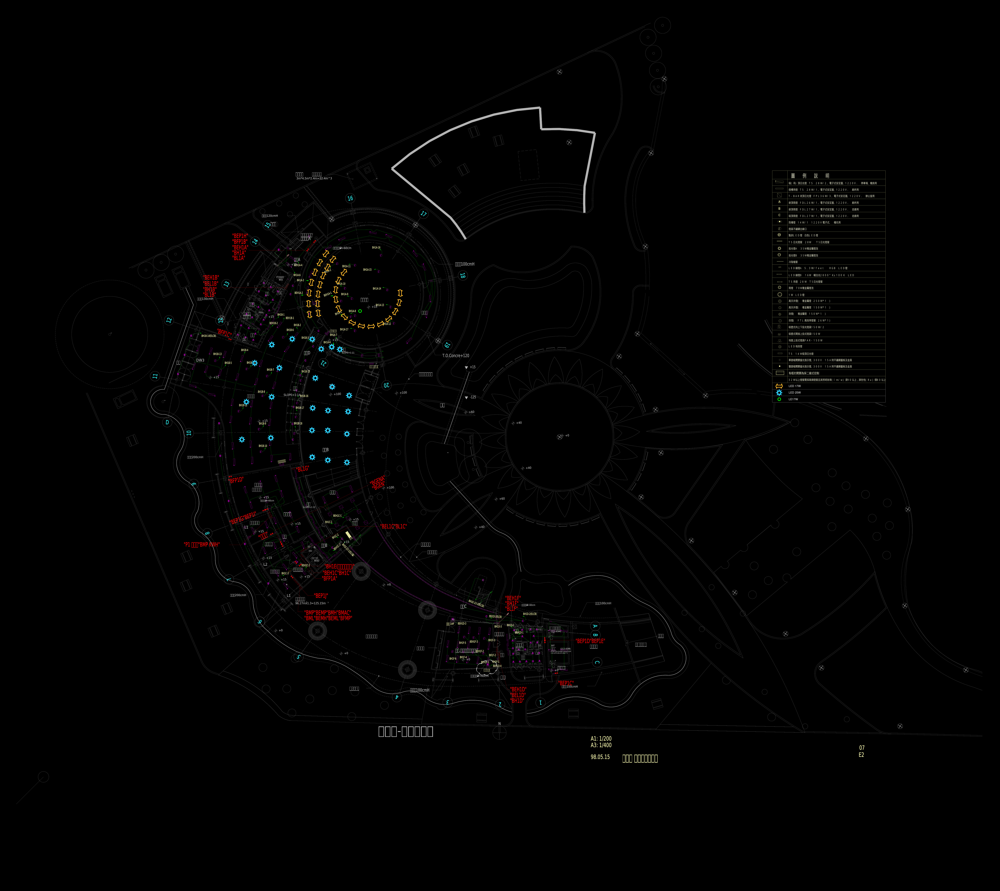
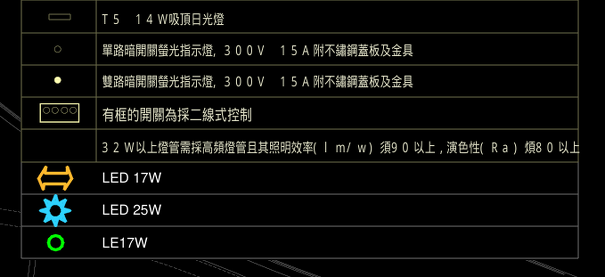
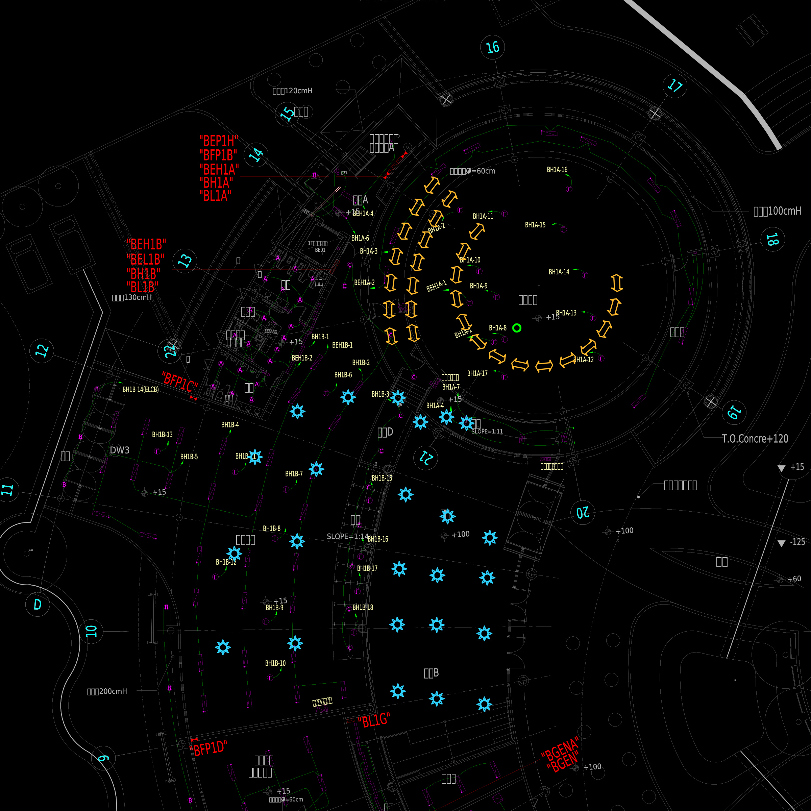

# 夢想館 1F 新增照明

## 最新：確認版 DXF

[下載確認版 DXF](確認版_v4/E2-07(夢想館1F燈具)_新增照明_確認版.dxf) · [確認版說明與驗證](確認版_v4/README.md)

內圈 14 個箭頭、外圈兩道同心弧各 7 個；24 個半尺寸太陽符號；BH1A-8 旁 1 個綠色空心圓。原右上角表格底部新增 LED 17W、LED 25W、LE17W 三列圖例。

DXF 已輸出並逐點核對通過，稽核 0 錯誤、0 修復；原始檔保留。

## 已確認的第四版 JPG 預覽

原右上角表格底部接續：箭頭 **LED 17W**、太陽花形 **LED 25W**、綠色空心圓 **LE17W**。第三版燈具配置維持不變。

[全圖 JPG](預覽_v4/夢想館1F_照明與圖例_待確認.jpg) · [完整表格 JPG](預覽_v4/右上角完整表格_待確認.jpg) · [第四版說明](預覽_v4/README.md)

本節為先前預覽紀錄；確認版 DXF 已於上方提供。

## 第三版 JPG 配置預覽

內圈 14 個箭頭；外圈兩道同心弧各 7 個（新增弧放在內側）；BH1A-8 旁新增綠色空心圓燈具。

[教室局部 JPG](預覽_v3/圓形教室_調整細節_待確認.jpg) · [預覽配置說明](預覽_v3/README.md)

本次僅供圖面確認，下面的 DXF 為上一版，尚未套用第三版配置。

## 上一版 CAD 與驗證資料

上一版已產出 CAD：24 個太陽符號縮為原尺寸的 50%，中心不變；15 個箭頭各分為兩個半長箭頭，共 30 個，每對總長、端點與方向不變。

- [下載 CAD DXF](E2-07(夢想館1F燈具)_新增照明_符號調整.dxf)
- [新增前後比對 PDF](符號調整_前後比對.pdf)
- [箭頭分割座標](箭頭分割座標.csv)
- [修改驗證紀錄](修改驗證.json)

圖層為 `NEW_LED_25W` 與 `NEW_LED_17W`；燈具為可編輯 CAD 圖元。修改後 ezdxf 稽核為 0 錯誤、0 修復；來源檔案未修改。

原圖注意事項：DXF 單位設定與圖中公分標註不一致，本次沿用原模型座標且未縮放底圖；原有建築與圖框 DWG 外部參考保持原狀，未內嵌，開啟時可能需要恢復其來源。圖示尺寸不代表實體燈具尺寸。
