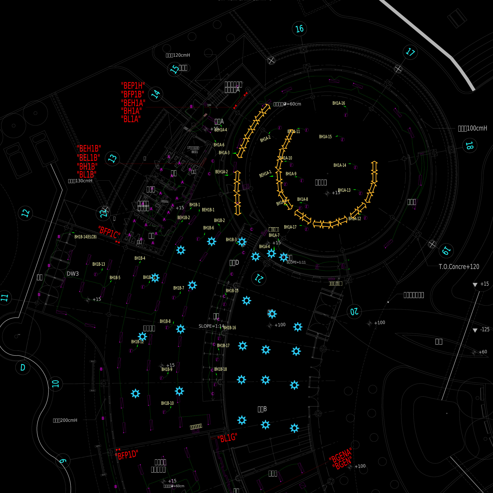

# 夢想館 1F 新增照明

最新版本：24 個太陽符號縮為原尺寸的 50%，中心不變；15 個箭頭各分為兩個半長箭頭，共 30 個，每對總長、端點與方向不變。

- [下載 CAD DXF](E2-07(夢想館1F燈具)_新增照明_符號調整.dxf)
- [新增前後比對 PDF](符號調整_前後比對.pdf)
- [箭頭分割座標](箭頭分割座標.csv)
- [修改驗證紀錄](修改驗證.json)

圖層為 `NEW_LED_25W` 與 `NEW_LED_17W`；燈具為可編輯 CAD 圖元。修改後 ezdxf 稽核為 0 錯誤、0 修復；來源檔案未修改。

原圖注意事項：DXF 單位設定與圖中公分標註不一致，本次沿用原模型座標且未縮放底圖；原有建築與圖框 DWG 外部參考保持原狀，未內嵌，開啟時可能需要恢復其來源。圖示尺寸不代表實體燈具尺寸。
