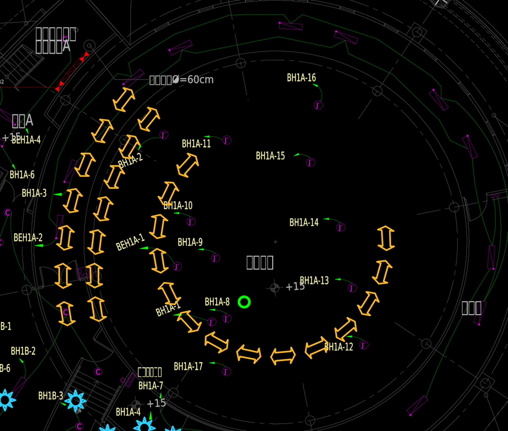

# 第三版配置預覽（待確認）

- 內圈箭頭：14 個。
- 外圈箭頭：兩道同心弧，各 7 個，共 14 個；新增一道位於原外圈內側。
- 箭頭合計：28 個。
- BH1A-8 右側：新增 1 個綠色空心圓代表燈具。
- 24 個太陽符號沿用上一版 50% 尺寸。

本次僅產生位置配置 JPG 供確認，未將此配置寫入 DXF，亦未覆寫上一版 CAD。弧形排列根據原有箭頭中心擬合後均勻分布；新增弧與原外弧使用相同圓心，內移距離為原箭頭符號寬度的兩倍（164.584 CAD 單位），屬待確認的配置選擇。

詳細配置座標及幾何見 `預覽配置.json`。圖面沿用原 CAD 座標，單位問題及既有外部參考狀況維持前版說明。
